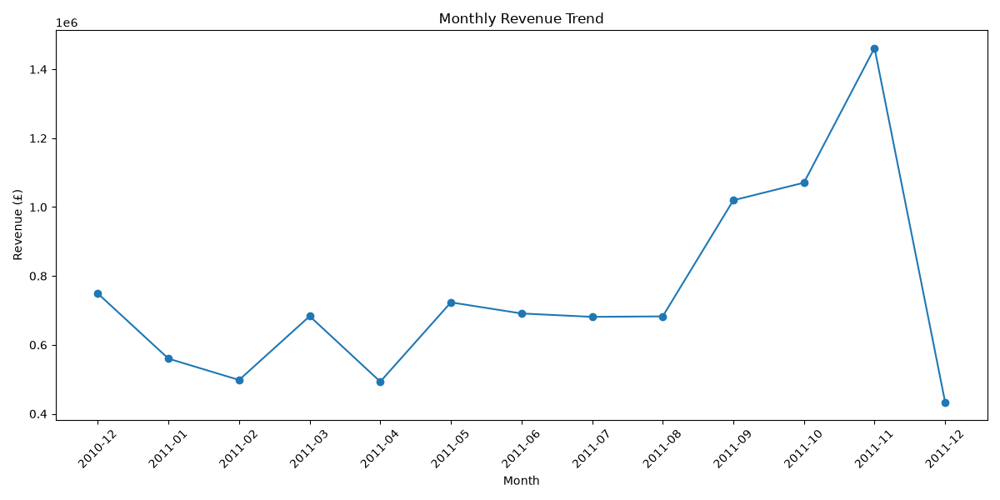
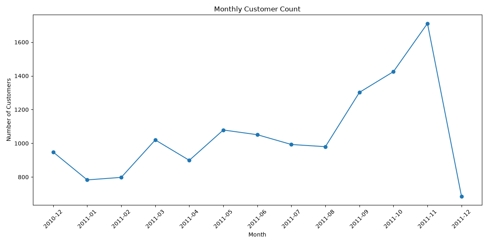
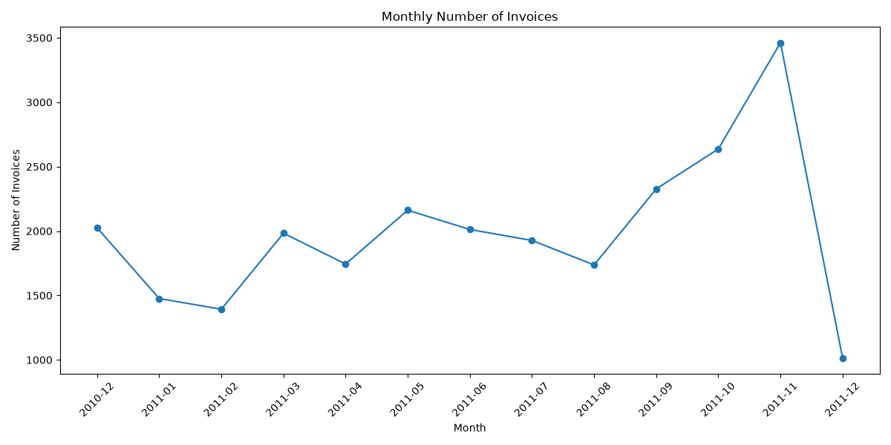
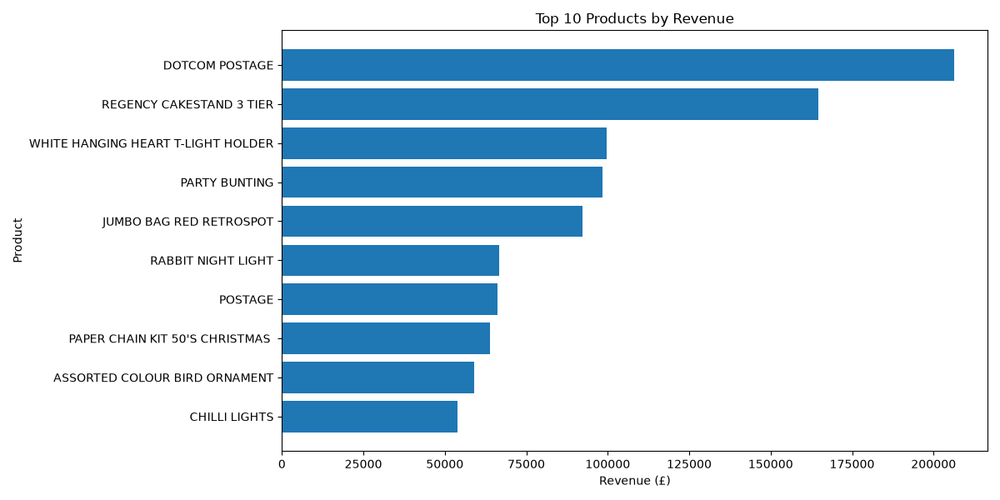
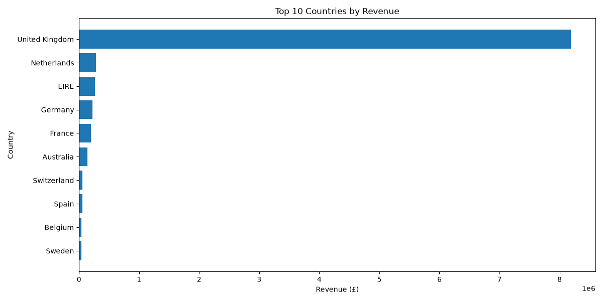

# Exploratory Analysis with a Finding

## Project Overview

This project performs exploratory data analysis on the UCI Online Retail dataset to identify meaningful trends, relationships, and business insights.

The analysis focuses on revenue, customers, invoices, products, countries, and monthly sales activity.

The main objective is not only to create visualizations, but to identify a finding that could be useful to a business stakeholder.

---

## Dataset

The dataset used is the **Online Retail dataset** from the UCI Machine Learning Repository.

It contains transactions from a UK-based online retailer between December 2010 and December 2011.

### Dataset Details

* Rows: 541,909
* Original columns: 8
* Unique invoices: 25,900
* Unique products: 4,070
* Unique customers: 4,372
* Countries: 38

The original dataset is stored locally in:

```text
data/raw/Online Retail.xlsx
```

The raw dataset is excluded from Git tracking using `.gitignore`.

---

## Data Quality Check

The analysis identified several data quality characteristics:

* 1,454 missing product descriptions
* 135,080 missing CustomerID values
* 5,268 duplicate rows
* 10,624 rows with negative quantities
* 2,515 rows with zero unit prices
* 2 rows with negative unit prices

Negative quantities and negative revenue were not automatically removed because they may represent returns or cancellations rather than simple data errors.

The dataset contains:

* 530,104 positive-revenue rows
* 9,290 negative-revenue rows
* 2,515 zero-revenue rows

---

## Analysis Performed

The analysis included:

1. Dataset structure and data-quality inspection
2. Missing-value analysis
3. Duplicate-row analysis
4. Revenue calculation
5. Monthly revenue analysis
6. Monthly customer analysis
7. Monthly invoice analysis
8. Revenue per customer analysis
9. Top products by revenue
10. Top countries by revenue
11. November 2011 product analysis
12. November 2011 country analysis

Revenue was calculated using:

```text
Revenue = Quantity × UnitPrice
```

---

## Key Finding

### November 2011 was the strongest sales month in the dataset

November 2011 generated **£1,461,756.25** in revenue.

The average revenue across the complete months, excluding December 2011 because it is an incomplete month, was **£776,173.33**.

Therefore, November revenue was approximately **88.3% above the average full-month revenue**.

November also recorded the highest values for several important business measures:

| Metric               | November 2011 |
| -------------------- | ------------: |
| Revenue              | £1,461,756.25 |
| Quantity Sold        |       740,286 |
| Invoices             |         3,462 |
| Customers            |         1,711 |
| Revenue per Customer |       £854.33 |

This indicates that the November revenue increase was accompanied by higher customer activity, more invoices, and greater sales volume rather than appearing only in the revenue figure.

---

## Product and Country Findings

The **United Kingdom** was the largest revenue contributor overall, generating approximately **£8.19 million** in revenue.

In November 2011, the United Kingdom also generated the largest revenue at approximately **£1.28 million**.

Some products appearing among the highest-revenue products in November included:

* DOTCOM POSTAGE
* RABBIT NIGHT LIGHT
* PAPER CHAIN KIT 50'S CHRISTMAS
* WHITE HANGING HEART T-LIGHT HOLDER
* REGENCY CAKESTAND 3 TIER
* CHILLI LIGHTS

These results show that several seasonal and gift-related products were among the high-revenue products during November.

The analysis identifies an association between November sales activity and these products, but does not claim that any individual product caused the overall revenue increase.

---

## Stakeholder Insight

For a business stakeholder, the main insight is that **November 2011 represented a period of unusually high commercial activity**.

Revenue was substantially above the average full-month level, while customer count, invoice count, and quantity sold also reached their highest observed values.

This suggests that the November performance was supported by both increased customer activity and higher transaction volume.

A business could use this type of analysis to investigate what factors contributed to the November increase, such as seasonal demand, product mix, promotions, or customer purchasing behavior.

---

## Visualizations

The project includes the following visualizations:

### Monthly Revenue Trend



### Monthly Customer Count



### Monthly Invoice Count



### Top 10 Products by Revenue



### Top 10 Countries by Revenue



---

## Important Limitation

December 2011 is an incomplete month in the dataset because the available transactions end on December 9, 2011.

Therefore, December's lower total revenue should not be directly compared with complete months.

The dataset also contains a large number of missing CustomerID values, which limits customer-level analysis for those transactions.

---

## How to Run

Make sure Python and the required packages are installed.

Install the dependencies with:

```bash
python -m pip install pandas openpyxl matplotlib
```

Run the analysis from the project root:

```bash
python src/eda.py
```

The generated charts are saved in:

```text
outputs/
```

---

## Project Structure

```text
exploratory-analysis-finding/
│
├── data/
│   ├── raw/
│   │   └── Online Retail.xlsx
│   └── processed/
│
├── notebooks/
│
├── outputs/
│   ├── monthly_revenue_trend.png
│   ├── monthly_customer_count.png
│   ├── monthly_invoice_count.png
│   ├── top_10_products_revenue.png
│   └── top_10_countries_revenue.png
│
├── src/
│   └── eda.py
│
├── .gitignore
└── README.md
```

---

## Conclusion

The exploratory analysis shows a clear increase in sales activity during September, October, and November 2011, with November reaching the highest observed revenue, customer count, invoice count, and quantity sold.

The analysis demonstrates how exploratory data analysis can move beyond charts to produce a measurable, stakeholder-focused business finding.
